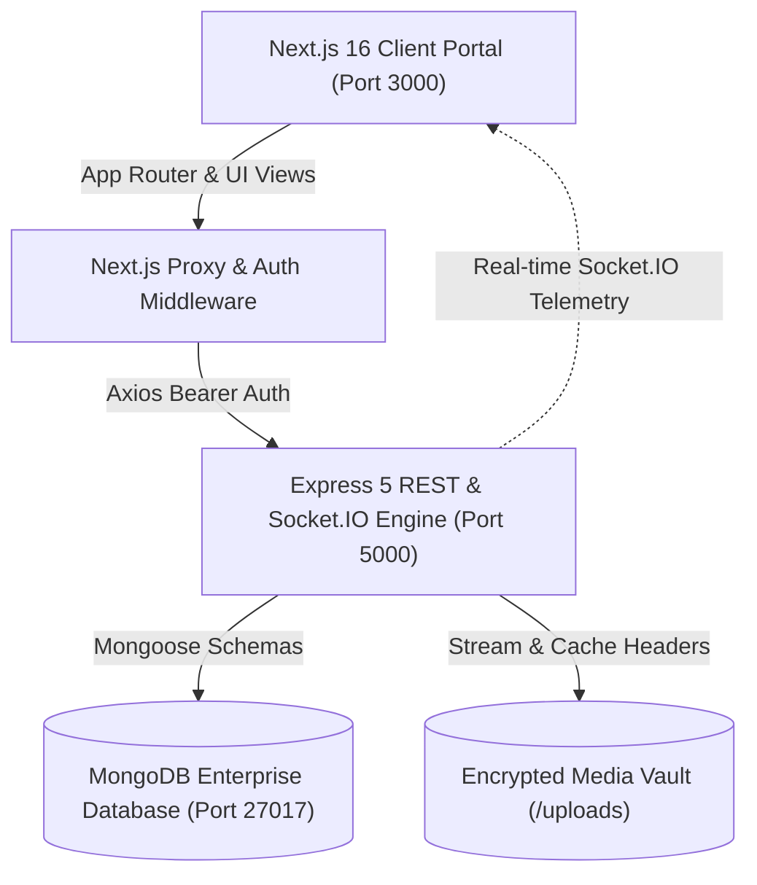

<div align="center">

# ⚡ QUANTUM DYNAMICS ⚡
### Next-Generation Enterprise Telemetry, Project Management & Neural Operations Matrix

[](https://nextjs.org/)
[](https://react.dev/)
[](https://www.typescriptlang.org/)
[](https://tailwindcss.com/)
[](https://nodejs.org/)
[](https://www.mongodb.com/)
[](https://socket.io/)
[](LICENSE)

<br/>

**Quantum Dynamics** is a unified, cyber-futuristic enterprise operations cockpit and telemetric project orchestration suite. Engineered with Next.js 16 (App Router & Turbopack), an Express 5 API with MongoDB, and Socket.IO real-time channels, it delivers military-grade telemetry, 42 pre-seeded mission initiatives, an encrypted media vault with zero-lag in-app lightbox streaming, and hardware-accelerated 60fps animations.

</div>

---

## 📑 Table of Contents

- [✨ Key Architectural Features](#-key-architectural-features)
- [🌌 System Architecture](#-system-architecture)
- [🚀 Quick Start Guide](#-quick-start-guide)
- [🔑 Pre-Seeded Default Credentials](#-pre-seeded-default-credentials)
- [🗂️ Unified Directory Blueprint](#️-unified-directory-blueprint)
- [📡 Comprehensive API Reference](#-comprehensive-api-reference)
- [🎨 Advanced Animation & UX Engine](#-advanced-animation--ux-engine)
- [⚙️ Environment Variables](#️-environment-variables)
- [👨‍💻 Author & Clearance](#-author--clearance)

---

## ✨ Key Architectural Features

### 1. 🎛️ Futuristic Command Cockpit
- **Live Real-Time Telemetry:** Global UTC mission clock, continuous laser sweep line, and dynamic operational health badges.
- **Interactive KPI Cards:** Real-time metrics for Active Projects, Neural Load %, Total Portfolio Units, and 100% Zero-Trust Mesh Integrity with multi-stop neon gradient meters.
- **Operations Velocity Matrix:** Scalable SVG vector chart with glowing holographic gradient path and pulsating telemetry nodes.
- **Real-Time Neural Feed:** Live operational timeline streaming user actions, security approvals, and project updates.

### 2. 🗃️ Enterprise Project Matrix (42 Pre-Seeded Initiatives)
- **42 Diverse Mission Portfolios:** Spans Quantum Computing, Autonomous Avionics, Hypersonic Defense, Bio-Synthetic Nanotech, Deep Sea Mapping, and Orbital Swarms.
- **Multi-Stage Milestones:** Interactive milestone tracking (`Completed`, `In Progress`, `Pending`) for every initiative.
- **Zero-Lag Pagination & Filters:** 7 paginated pages (6 entries/page), multi-field search (title, client, lead architect), and status chips (`Planning`, `In Progress`, `Completed`, `On Hold`).
- **Direct Vault Linking:** Schematics, blueprints, firmware binaries, and security audits from the Media Vault are linked directly to corresponding projects.

### 3. 🔐 Encrypted Quantum Media Vault
- **Direct On-Screen Lightbox (No Forced Downloads):** Clicking any asset opens a high-tech modal on screen without downloading.
- **Holographic Loading Indicator:** Real-time rendering spinner with `RENDERING ASSET PAYLOAD...` feedback.
- **Multi-Payload In-App Decoders:**
  - **Images (`.jpg`, `.png`, `.svg`):** Progressive image canvas with high-tech `.skeleton-shimmer` placeholders.
  - **Video Streams (`.mp4`):** Integrated in-app HTML5 video player with seek controls and autoplay.
  - **Documents (`.pdf`):** Embedded document reader iframe directly on screen.
  - **Firmware Archives (`.zip`):** Cryptographic verification inspector with payload size and local unpack actions.
- **Zero-Latency In-Memory Filtering:** Instant switching between **All** (17), **Images** (10), **Videos** (3), **Documents** (2), and **Archives** (2) with live count pills.

### 4. ⚡ Silk-Smooth 60fps Scrolling & GPU Acceleration
- Ambient background glows are isolated to dedicated GPU compositor layers (`transform-gpu`, `translate-z-0`).
- Overscroll containment (`overscroll-behavior-y: contain`) and Next.js `data-scroll-behavior="smooth"` prevent route-change stutter.

---

## 🌌 System Architecture



---

## 🚀 Quick Start Guide

### Prerequisites
- **Node.js**: v18.0.0 or higher
- **MongoDB**: Local MongoDB instance (`mongodb://127.0.0.1:27017`) or free MongoDB Atlas cluster
- **npm** or **pnpm**

### Step 1: Clone Repository
```bash
git clone https://github.com/bharat-kumaar/Quantum-Dynamics.git
cd Quantum-Dynamics
```

### Step 2: Install All Dependencies
A single root command installs dependencies for the root orchestrator, the backend, and the frontend:
```bash
npm run install:all
```

### Step 3: Configure Environment Variables
Copy the example environments:
```bash
# Backend configuration
cp quantum-dynamics-backend/.env.example quantum-dynamics-backend/.env

# Frontend configuration
cp quantum-dynamics-frontend/.env.example quantum-dynamics-frontend/.env.local
```

### Step 4: Run Unified Fullstack App
Launch both the backend API and Next.js 16 frontend concurrently with one command:
```bash
npm run dev
```

- **Frontend Application:** [http://localhost:3000](http://localhost:3000)
- **Backend API:** [http://localhost:5000/api](http://localhost:5000/api)

---

## 🔑 Pre-Seeded Default Credentials

The system automatically initializes and seeds an admin account and team operatives on first run:

| Parameter | Value |
| :--- | :--- |
| **Admin Email** | `bharatkumar70233@gmail.com` |
| **Password** | `password123` |
| **Clearance Role** | `Admin / Core Engineering Lead` |
| **Database State** | **42 Projects**, **17 Media Assets**, **4 Team Operatives** |

*(You can also register new operatives anytime via the `/register` portal)*

---

## 🗂️ Unified Directory Blueprint

```
Quantum-Dynamics/
├── package.json                         # Root orchestrator running both apps concurrently
├── README.md                            # Comprehensive enterprise documentation
├── .gitignore                           # Git exclusion rules
│
├── quantum-dynamics-backend/            # Express 5 API & Real-time Server
│   ├── server.js                        # HTTP server, Socket.IO, static route handling
│   ├── .env.example                     # Sample backend environment
│   ├── uploads/                         # Encrypted media storage directory (.gitkeep)
│   └── src/
│       ├── config/
│       │   ├── db.js                    # MongoDB connector with auto-memory fallback
│       │   └── seedProjectsAndMedia.js  # Seeds 42 enterprise projects & media catalogue
│       ├── controllers/
│       │   ├── authController.js        # JWT issuance, login, registration, OTP verify
│       │   ├── projectController.js     # Project CRUD, milestones, attachment linking
│       │   ├── mediaController.js       # Stream endpoints, smart category regex, caching
│       │   ├── dashboardController.js   # Telemetry metrics, neural feed, CSV export
│       │   └── teamController.js        # Operative profiles and clearance matrices
│       ├── middleware/
│       │   ├── authMiddleware.js        # JWT verification & admin guard
│       │   └── uploadMiddleware.js      # Multer file ingestion & sanitization
│       ├── models/
│       │   ├── user.js                  # User identity & role schema
│       │   ├── project.js               # Project, milestone & attachment schema
│       │   └── media.js                 # Media metadata & file reference schema
│       └── routes/                      # Express route definitions (/api/*)
│
└── quantum-dynamics-frontend/           # Next.js 16 App Router UI
    ├── package.json                     # Frontend dependencies & Next scripts
    ├── .env.example                     # Sample frontend environment
    └── src/
        ├── app/
        │   ├── layout.tsx               # Root layout, GPU blur containment & toaster
        │   ├── globals.css              # Cyber keyframes, laser sweeps, smooth scroll
        │   ├── (auth)/login/            # Holographic authentication gateway
        │   └── (dashboard)/
        │       ├── page.tsx             # Futuristic Command Cockpit dashboard
        │       ├── projects/page.tsx    # 42-project paginated matrix table
        │       ├── projects/[id]/page.tsx # Project details, timeline & attachments
        │       ├── media/page.tsx       # Quantum Media Vault with progressive thumbnails
        │       └── team/page.tsx        # Team clearance matrix
        ├── components/
        │   ├── layout/Sidebar.tsx       # Cyber sidebar with rotating orbit rings
        │   ├── layout/Header.tsx        # Universal debounced search & notifications
        │   └── media/MediaPreviewModal.tsx # In-app lightbox viewer (video, img, pdf, zip)
        ├── services/                    # Axios service wrappers for all backend domains
        └── types/                       # Strict TypeScript interfaces
```

---

## 📡 Comprehensive API Reference

All protected endpoints require an `Authorization: Bearer <JWT>` header.

### Authentication & Identity
| Method | Endpoint | Description | Auth Required |
| :--- | :--- | :--- | :---: |
| `POST` | `/api/auth/register` | Register new user account | No |
| `POST` | `/api/auth/login` | Authenticate and retrieve JWT token | No |
| `GET` | `/api/auth/me` | Fetch authenticated operative identity | Yes |

### Projects Matrix
| Method | Endpoint | Description | Auth Required |
| :--- | :--- | :--- | :---: |
| `GET` | `/api/projects` | Query projects with search, filter, pagination | Yes |
| `GET` | `/api/projects/:id` | Retrieve project details, milestones & attachments | Yes |
| `POST` | `/api/projects` | Initialize new project initiative | Yes |
| `PUT` | `/api/projects/:id` | Update project specifications | Yes |
| `DELETE` | `/api/projects/:id` | Decommission project from matrix | Yes (Admin) |
| `POST` | `/api/projects/:id/milestones` | Record milestone in project timeline | Yes |

### Quantum Media Vault
| Method | Endpoint | Description | Auth Required |
| :--- | :--- | :--- | :---: |
| `GET` | `/api/media` | Fetch media assets (supports `?type=` smart filter) | Yes |
| `GET` | `/api/media/file/:filename` | Stream asset with caching headers | No (Direct) |
| `POST` | `/api/media/upload` | Ingest asset into vault & link to project | Yes |
| `DELETE` | `/api/media/:id` | Purge asset from vault and database | Yes |

### Telemetry Dashboard
| Method | Endpoint | Description | Auth Required |
| :--- | :--- | :--- | :---: |
| `GET` | `/api/dashboard/metrics` | Calculate operational load & project KPIs | Yes |
| `GET` | `/api/dashboard/activities` | Fetch recent neural telemetry audit feed | Yes |
| `GET` | `/api/dashboard/search` | Universal search across projects & personnel | Yes |
| `GET` | `/api/dashboard/export` | Download full CSV telemetry report | Yes |

---

## 🎨 Advanced Animation & UX Engine

Built directly into [`globals.css`](quantum-dynamics-frontend/src/app/globals.css):

- **`animate-laser-beam`**: 2.8s sweeping neon cyan laser light traversing headers.
- **`animate-cyber-scan`**: Hover-triggered holographic scanner traveling down cards.
- **`animate-holo-float`**: Smooth vertical levitation for badges and command icons.
- **`skeleton-shimmer`**: GPU-accelerated gradient loading shimmer for high-res assets.
- **`smooth-scroll`**: Hardware-accelerated touch/wheel scroll with zero layout jitter.

---

## ⚙️ Environment Variables

### Backend (`quantum-dynamics-backend/.env`)
```env
PORT=5000
NODE_ENV=development
MONGO_URI=mongodb://127.0.0.1:27017/quantum-dynamics-db
JWT_SECRET=quantum_dynamics_jwt_super_secret_key_2026
JWT_EXPIRES_IN=7d
EMAIL_USER=your_email@gmail.com
EMAIL_PASS=your_app_password
```

### Frontend (`quantum-dynamics-frontend/.env.local`)
```env
NEXT_PUBLIC_API_URL=http://localhost:5000/api
```

---

## 👨‍💻 Author & Clearance

- **Author:** [Bharat Kumar](https://github.com/bharat-kumaar)
- **Role:** Full-Stack Systems Architect & Developer
- **Clearance Level:** Level 5 Executive Matrix
- **GitHub:** [@bharat-kumaar](https://github.com/bharat-kumaar)

---

<div align="center">
  <sub>Engineered with precision for Quantum Dynamics Systems © 2026. All rights reserved.</sub>
</div>
